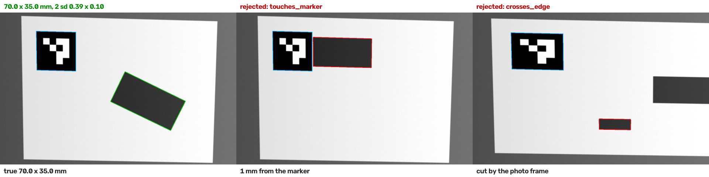

# photo-size-check

Measure a flat object from one photo, using printed ArUco markers of known size, and refuse to answer when the result cannot be trusted.

I built this with Claude Code. The point of the repo is how the code is checked: every number is compared with a size known to be true, first on synthetic photos, then on real phone photos. [LOG.md](LOG.md) lists what those checks and an independent review found, including what I got wrong.



*Synthetic examples. Left: measured, with its uncertainty. Middle and right: refused, with the reason.*

## Results on real photos

**Set-up.** I had no printer or ruler, so a 14-inch MacBook Pro screen was the reference. At 254 ppi it shows exactly 10 px per mm, and the slides draw the markers and test shapes in millimetres (`scripts/make_screen_slides.py`). A phone (Xiaomi, 1× lens, HDR and AI off) photographed them from straight on and at about 35–40°.

**Protocol.**
- Round B (17 photos) set the one real-camera parameter.
- Round C (17 photos, different shapes) was then measured once.
- The settings were committed (8d28101) before round C was measured (5ccc542).

| Round C, 4 markers in the screen's corners | |
|---|---|
| should be refused (two objects; an object crossing the screen edge) | 4/4 refused |
| should be measured | 10/13 measured. Refused: a 140 x 20 mm strip twice (2 sd over 5% of its width) and one blurred photo |
| error | 0.86% (length) and 1.00% (width) too small, at most 0.89 mm |
| true size inside ±2 reported sd | 20/20 sizes |
| same photos, first marker alone | 2.3% / 2.9% too small; inside ±2 sd: 50% / 40% |

**What this shows.**
- With four markers around the object, the reported uncertainty held on photos it had never seen.
- With one marker it does not hold. Use four.

**What it does not show.**
- Objects drawn on a screen are not real objects: no thickness, no shadows, no materials.
- 34 + 24 photos from one phone and one screen are a small sample.
- **An unexplained bias remains.** Objects come out about 1% small: their outlines sit 0.2–0.5 mm inside the true edges, while the markers' edges do not. Several causes were tested and ruled out (LOG.md). A segmentation model's outline does not share it, which places the bias in the edge step (below). Nothing in the code corrects it. It is carried as uncertainty (the camera term), not removed.

## How it measures (`photosize/measure.py`)

1. **Find the markers.** Find the board's markers: one, or several at known positions (`Board`). Refine each corner by fitting straight lines along the marker's edges.
2. **Map to millimetres.** Fit a homography from all marker corners to their positions in mm. With several markers this is a least-squares fit, and a one-parameter radial lens distortion is estimated as the value that lets all corners fit one plane best.
3. **Normalise the scale.** Reduce the photo so the markers have about 5 px per mm. Every pixel setting then has the same physical meaning in any photo.
4. **Find the sheet.** Find the light sheet that carries the markers.
5. **Find the object.** Mark what is clearly darker than the sheet right there. A first pass finds the clear objects; a second pass estimates the sheet's own local brightness without them, so dim edges and reflections are not "dark".
6. **Refuse when unsure.** If anything is ambiguous, refuse with a code (table below).
7. **Measure the outline.** Sub-pixel outline, then the minimum-area box gives length × width. For near-circles, where that box's angle is just noise, the longest and shortest sides over all equally tight boxes are used.
8. **Estimate the uncertainty.** It combines:
   - **marker corners**, through a Jacobian;
   - **the outline's edge error**, including the real-camera term;
   - **how sharply the box orientation is defined**;
   - **the markers' misfit** to one plane.

`measure(image, 40.0)` uses one 40 mm marker. `measure(image, Board(...))` uses several. `camera_edge_mm` defaults to the value calibrated on real photos; pass 0 for synthetic photos.

| code | meaning |
|---|---|
| `no_marker`, `marker_count` | no marker, or not exactly the board's markers (also: a blurred photo) |
| `marker_too_small` | marker side under 40 px |
| `markers_disagree` | corners miss one flat plane by > 1 mm rms (wrong board, curled sheet) |
| `no_sheet` | no light surface around the markers (also: a bright window behind the sheet) |
| `no_object`, `object_too_small` | nothing darker than the sheet, or only specks |
| `several_objects` | more than one object |
| `touches_marker` | the object touches a marker |
| `crosses_edge` | a dark region reaches ≥ 5 mm into the sheet from its edge or the photo's edge |
| `low_contrast` | object less than 25 grey levels darker than the sheet |
| `unclear_edge` | the fine outline runs along the limit of its search band |
| `too_uncertain` | 2 sd above 5% of the length or the width |

## Why the uncertainty uses a Jacobian, not Monte Carlo

The first version jittered the marker corners 32 times and took the sd. The comparison below comes from `scripts/uncertainty_methods.py` on 30 scenes:
- **The 32-sample sd was itself noisy.** It moved by 10% (median; max 13%) with the random seed alone, so the "too uncertain" check and the coverage figure depended on luck.
- **The Jacobian matches a slow, accurate Monte Carlo.** Against 4,000 samples the ratio has a median of 1.01 and a range of 0.92–1.23.
- **It is deterministic and cheaper.** No random generator and nothing shared between threads; 0.19 ms instead of 0.35 ms.
- **Its limit is linearity.** Corner errors are about 0.05 px, so the linear approximation holds.

## Synthetic checks

`photosize/synth.py` renders photos whose true sizes are exact:
- a sheet on a table, with markers and rectangles or ellipses;
- a random camera homography;
- area-integrated pixels;
- blur, uneven light, noise and JPEG.

Calibration uses seed 1000. Evaluation and tests use other seeds.

| 2,000 held-out scenes (`evaluate.py --n 2000 --seed 2`) | one 40 mm marker | four 30 mm markers (`--four`) |
|---|---|---|
| median error, length / width | 0.06 / 0.04 mm | 0.03 / 0.02 mm |
| p95 / max error, length | 0.24 / 0.83 mm | 0.05 / 0.13 mm |
| true size inside ±2 sd | 98.7% / 98.8% | 99.7% / 100% |

**Radial lens distortion** (`scripts/lens_distortion.py`, k1 = 0.10):
- One marker: median error 0.83%, 50% inside ±2 sd.
- Four markers: 0.03% and 100%.
- Caveat: the synthetic distortion has the same one-parameter form the code estimates, so this shows the method works, not that real lenses follow that form.

## Compared with an open-source segmentation model

`scripts/compare_segmentation.py` replaces step 5 (finding the object) with U²-Netp: the small U²-Net, Apache-2.0, 4.6 MB, run by OpenCV's own DNN module, so no new dependency (`photosize/segment_model.py`). Everything else stays the same. Three variants on the same sets:

| | classical | model + classical outline | model's own outline |
|---|---|---|---|
| 200 held-out synthetic scenes: median / max error | 0.018 / 0.069 mm | 0.018 / 0.069 mm | 0.210 / 0.853 mm |
| synthetic: true size inside ±2 sd | 100% | 100% | 29% |
| the review's 32 scenes | all right or refused | no wrong size; 11 measurable grey objects refused | **8 wrong sizes accepted** (grey objects: 60 mm read as 45 mm) |
| real photos, round C: median error, mean bias | 0.48 mm, −0.9% | the same | 0.16 mm, −0.2% |
| time per real photo, one CPU thread | 0.62 s | 0.90 s | 0.90 s |

**What it shows.**
- **The model does not replace the classical step.** With the classical outline it adds time and refuses grey objects the classical step measures. On its own it is 12 times less precise on synthetic photos, and it accepts wrong sizes, because the checks that catch an unreliable outline (contrast, edge found near the coarse one) belong to the classical edge step.
- **First run:** the model segmented the four markers instead of the object. The markers and the table are now painted with the sheet's grey before the model sees the photo.
- **On real photos, the model's own outline is closer to the truth:** median error 0.16 mm against 0.48 mm, and a fifth of the bias. So the ~1% bias that remains on real photos sits in the classical edge step (the halfway threshold), not in the markers or the mapping. This is a lead, not a fix: changing the edge step needs its own calibration round and a new locked test round, because round C has been used.

The model is not offered by the HTTP API.

## HTTP API

```
pip install -r requirements-api.txt
uvicorn photosize.api:app --workers 2
curl -F image=@photo.jpg -F marker_mm=40 localhost:8000/v1/measure
curl -F image=@photo.jpg -F 'board={"side_mm": 30, "markers": {"0": [10, 10], "1": [160, 10]}}' localhost:8000/v1/measure
```

`ok` decides everything. A measurable photo:

```json
{"ok": true, "length_mm": 59.872, "width_mm": 29.976, "length_sd_mm": 0.581, "width_sd_mm": 0.556,
 "problems": [], "markers_found": 1, "misfit_mm": null, "version": "0.3.0"}
```

A photo that cannot be trusted still gets HTTP 200, but every size is null, so a frontend cannot show a wrong number by accident. Codes are those in the table above:

```json
{"ok": false, "length_mm": null, "width_mm": null, "length_sd_mm": null, "width_sd_mm": null,
 "problems": [{"code": "several_objects", "detail": "2 dark objects on the sheet (areas px: 53610, 42128)"}],
 "markers_found": 1, "misfit_mm": null, "version": "0.3.0"}
```

Bad requests get their own codes: `bad_image` (400), `bad_reference` (400: give exactly one of `marker_mm` or `board`), `image_too_large` (413: over 25 MB, or over 64 MP read from the JPEG or PNG header before anything is decoded).

**Concurrency.** Endpoints are plain functions, so FastAPI runs them in its thread pool. At most one measurement per CPU core runs at a time, each with one OpenCV thread; more requests wait their turn.

## Tests

`pytest` runs 51 tests in about 20 s:
- every scene from the independent review (an object near or touching a marker, several objects, edge crossings, grey and faint objects, an empty sheet, no marker, objects in sheet corners);
- the oracle itself;
- missing or misplaced board markers;
- distortion with one vs four markers;
- concurrency, and evaluation that does not depend on worker count;
- the HTTP API: sizes, refusals without sizes, request errors, the header check, parallel requests;
- the model: a file with the wrong checksum is refused, and it finds the object, not the markers.

CI runs `mypy --strict` and the tests on every push. It fetches the model once, checks its SHA-256 and caches it.

## Cost and concurrency

- **Cost.**
  - A 15 MP phone photo takes about 0.25 s on my laptop's CPU, because it is reduced to the working scale first.
  - The default path has no model and no API call. The optional U²-Netp adds about 0.3 s per photo on one CPU thread; it is used only for the comparison.
  - The uncertainty maps only the outline's convex hull (tens of points) to mm. Against the full outline, the largest difference was 3e-5 mm over 300 homographies.
- **Concurrency.**
  - `measure()` holds no shared state and uses no random numbers.
  - The evaluation gives each scene its own child seed, so results do not depend on worker count.
  - Worker processes are started with spawn on every platform: forking after OpenCV has started its thread pool hung the first Linux CI run.
  - Workers run OpenCV with one thread each.
  - Only the parent process writes files.

## Known limits

- **Only screen-drawn shapes are tested on real photos.** No printed sheet and no real objects yet.
- **The ~1% bias on real photos is unexplained.** It is covered by the uncertainty, not corrected. The camera term (0.39 mm per side) is calibrated for this phone and screen; another set-up needs its own calibration round.
- **Thin objects are refused.** With that term, objects narrower than about 22 mm are refused as `too_uncertain`.
- **Printed marker scale.** `Board` sizes must be measured on the print. A sheet printed at 97% makes everything about 3% too large, and no photo can show it.
- **Exposure.** A bright window behind the sheet, or a blurred photo, gives a refusal, not a size.
- **Shape.** Flat objects only. Touching objects are measured as one.

## Run

```
python -m venv .venv && .venv/bin/pip install -r requirements-api.txt
.venv/bin/python -m pytest -q
.venv/bin/python evaluate.py [--four]             # synthetic error statistics; worst overlays in debug/
.venv/bin/python scripts/calibrate.py            # corner and edge error sizes (synthetic, seed 1000)
.venv/bin/python scripts/make_screen_slides.py   # real/screen_slides*.html and the true sizes
.venv/bin/python scripts/measure_photos.py --photos DIR --slides real/slides_v2.json --order ... --out DIR
.venv/bin/python scripts/calibrate_real.py real/results/v2_B/results.csv
.venv/bin/python scripts/compare_segmentation.py  # classical vs U^2-Netp; downloads the model (4.6 MB) once
.venv/bin/uvicorn photosize.api:app                # HTTP API (pip install -r requirements-api.txt)
```

Raw photos are not in the repository: they are large and show the room around the screen. The per-photo results are in `real/results/*/results.csv`.
